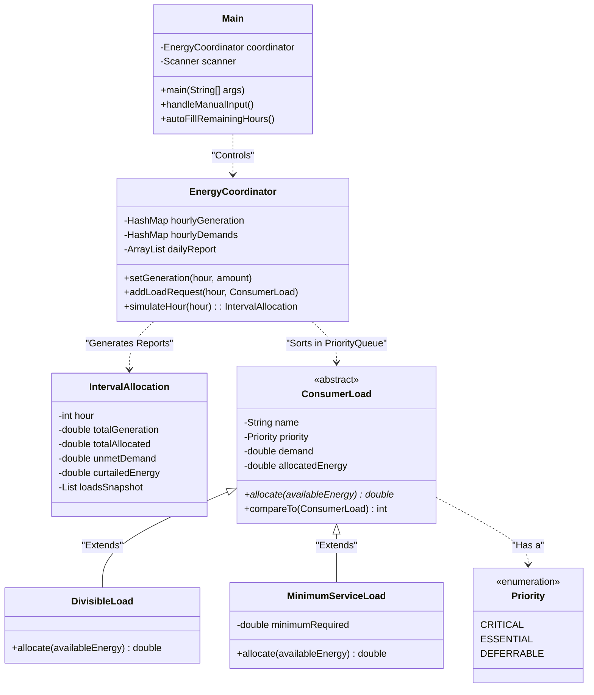
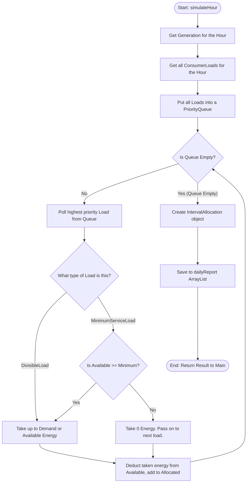

# Code Architecture Visualizations

To help you and the jury understand how the code is structured, here are two visualizations. You can use these concepts to draw diagrams on a whiteboard or presentation slide.

## 1. Class Structure (Object-Oriented Design)

This diagram shows how the different Java files (classes) relate to each other. 
*   **Solid arrows** mean "inherits from" (e.g., `DivisibleLoad` is a type of `ConsumerLoad`).
*   **Dotted arrows** mean "uses" or "contains" (e.g., the `EnergyCoordinator` uses `ConsumerLoad` objects).

### Key Takeaways for the Jury:
*   The `Main` class only handles the user interface (Console). It knows nothing about how energy is calculated.
*   The `EnergyCoordinator` is the "Brain". It stores data and runs the math.
*   `ConsumerLoad` is **Abstract**. It forces `DivisibleLoad` and `MinimumServiceLoad` to define their own specific rules for how they take energy (Polymorphism).

---

## 2. Execution Flow: How an Hour is Simulated

This flowchart shows what happens under the hood when you hit "Simulate Hour" in the console. This visualizes the logic inside `EnergyCoordinator.simulateHour(int hour)`.

### Key Takeaways for the Jury:
*   The **PriorityQueue** automatically pushes Critical loads to the front of the line, guaranteeing they are evaluated first.
*   The logic branches differently depending on the **Type of Load** being evaluated, demonstrating how the Minimum Service constraint actively prevents wasting energy.
